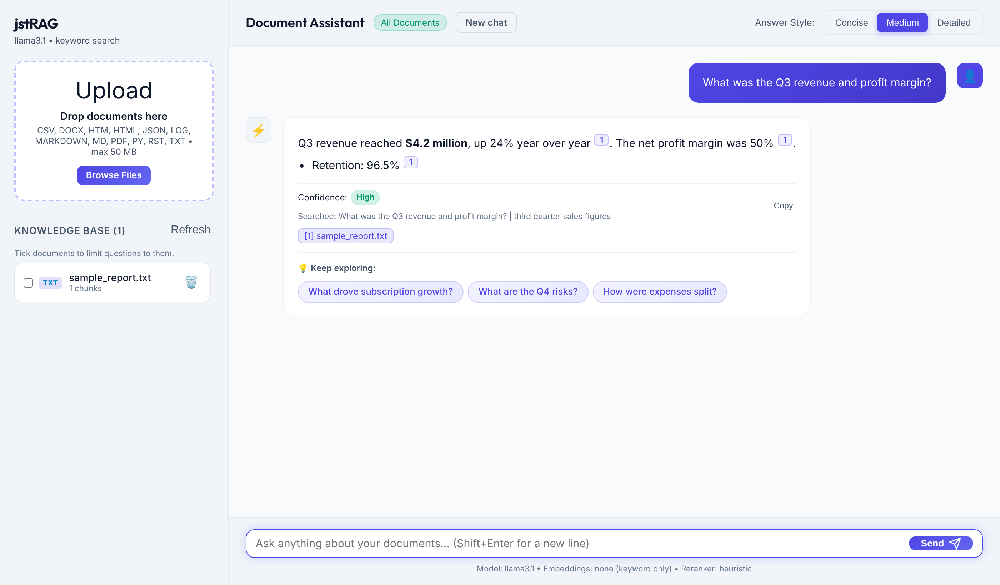
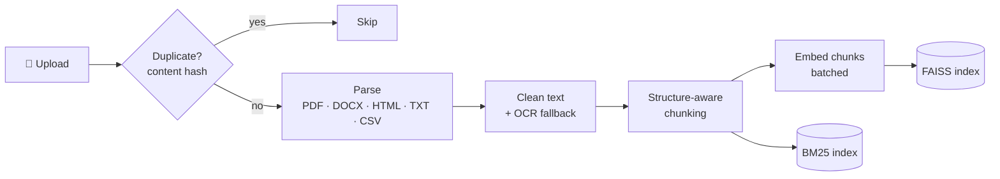
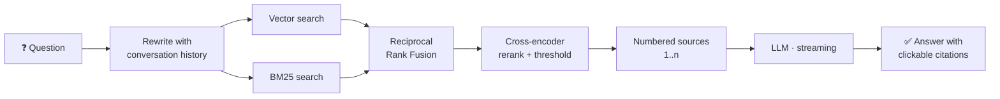

<div align="center">

# 📚 jstRAG — Advanced RAG System

**Chat with your documents. Get grounded answers with clickable citations.**

Hybrid search · Cross-encoder reranking · Streaming answers · Gemini, OpenAI or fully local models

[](https://www.python.org/)
[](https://fastapi.tiangolo.com/)
[](https://github.com/facebookresearch/faiss)
[](#-choosing-a-model)
[](#-testing)
[](#-contributing)

[Features](#-features) · [Quick Start](#-quick-start) · [How It Works](#-how-it-works) · [Configuration](#%EF%B8%8F-configuration) · [API](#-api-reference)



</div>

---

## 📖 Table of Contents

- [Overview](#-overview)
- [Features](#-features)
- [Quick Start](#-quick-start)
- [Choosing a Model](#-choosing-a-model)
- [How It Works](#-how-it-works)
- [Configuration](#%EF%B8%8F-configuration)
- [API Reference](#-api-reference)
- [Project Structure](#%EF%B8%8F-project-structure)
- [Testing](#-testing)
- [Troubleshooting](#%EF%B8%8F-troubleshooting)
- [Contributing](#-contributing)
- [License](#-license)

---

## 🔍 Overview

**jstRAG** is a self-hosted Retrieval-Augmented Generation (RAG) application. Upload PDFs, Word documents, web pages, or notes, then ask questions in natural language. Every answer is built **only** from your documents and cites its sources with numbered markers like `[1]`. Click a marker to see the exact passage it came from.

It is built to keep working when things go wrong:

| Situation | What happens |
|---|---|
| ✅ LLM configured | Streaming, AI-written answers with citations and follow-up suggestions |
| ⚠️ API quota exhausted / invalid key | An extractive answer from the most relevant sentences, **with the reason shown** |
| 🔌 No LLM at all | Still useful: cited extractive answers |
| 🧩 No embedding model | Falls back to BM25 keyword search |
| ❓ Question not covered by the documents | *"I couldn't find this in the uploaded documents."* No guessing. |

---

## ✨ Features

<table>
<tr>
<td width="50%" valign="top">

### 📥 Ingestion
- **PDF** (with OCR fallback for scanned pages), **DOCX**, **HTML**, **TXT / Markdown / RST**, **CSV**, **JSON**, **Python**
- Tables and headings kept in reading order
- Duplicate detection by **content hash**
- Re-uploading a file with the same name **replaces** the old version
- Upload size limits and safe file handling

</td>
<td width="50%" valign="top">

### 🔎 Retrieval
- **Structure-aware chunking** with section paths and page ranges
- **Hybrid search**: FAISS vectors + BM25, merged with Reciprocal Rank Fusion
- **Cross-encoder reranking** with a relevance threshold
- **Conversation-aware** query rewriting for follow-up questions
- **Whole-document summaries** that sample the entire file

</td>
</tr>
<tr>
<td width="50%" valign="top">

### 💬 Answers
- **Streaming** responses (Server-Sent Events)
- Inline **`[n]` citations** linked to the exact passage
- **Concise / Medium / Detailed** styles
- Confidence labels derived from reranker relevance
- AI-generated **follow-up questions**
- Prompt-injection guard for document content

</td>
<td width="50%" valign="top">

### 🖥️ Interface & Ops
- Clean web UI, no build step, works **offline**
- Scope questions to selected documents
- Stop, New chat, Copy answer
- Status endpoint showing active components
- Pluggable LLMs: **Gemini**, **OpenAI**, **Ollama**, LM Studio, vLLM
- Offline **pytest** suite

</td>
</tr>
</table>

---

## 🚀 Quick Start

### Prerequisites

- Python **3.9+**
- *(Optional)* A [Gemini API key](https://aistudio.google.com/apikey), an OpenAI key, or a local [Ollama](https://ollama.com/) install

### Installation

```bash
# 1. Clone the repository
git clone https://github.com/DEBANJAN-KAKATI/advanced-rag-system.git
cd advanced-rag-system

# 2. Create a virtual environment (recommended)
python -m venv .venv
source .venv/bin/activate          # Windows: .venv\Scripts\activate

# 3. Install dependencies
pip install -r requirements.txt

# 4. Configure (optional; every setting has a sensible default)
cp .env.example .env               # then set GEMINI_API_KEY=...

# 5. Run
python run.py
```

The app opens automatically at **http://localhost:8000**. Drop a document into the sidebar and start asking questions.

> [!TIP]
> For a much smaller install on machines without a GPU, install the CPU build of PyTorch first:
> `pip install torch --index-url https://download.pytorch.org/whl/cpu`

---

## 🤖 Choosing a Model

| Setup | `.env` settings | Notes |
|---|---|---|
| **Gemini** *(default)* | `GEMINI_API_KEY=your-key` | Free tier available. Uses `gemini-flash-latest` for answers and `gemini-embedding-001` for embeddings. |
| **Fully local (Ollama)** | `LLM_PROVIDER=openai`<br>`OPENAI_BASE_URL=http://localhost:11434/v1`<br>`LLM_MODEL=llama3.1` | No API key, no quota, nothing leaves your machine. Embeddings and reranking run locally. |
| **OpenAI** | `LLM_PROVIDER=openai`<br>`OPENAI_API_KEY=sk-...`<br>`LLM_MODEL=gpt-4o-mini` | Any OpenAI-compatible server works the same way. |
| **No LLM** | *(nothing)* | Cited, extractive answers built from the most relevant sentences. |

> [!NOTE]
> Changing the embedding model is safe: the index detects the change and re-embeds your documents automatically on the next start.

---

## 🧠 How It Works

### Ingestion pipeline



### Question-answering pipeline



1. **Query rewriting**: the question and recent conversation become a standalone query plus up to two alternative phrasings, so *"and what about Q4?"* searches for the right thing.
2. **Hybrid retrieval**: all queries are embedded in a single call and searched in FAISS, BM25 runs in parallel, and the ranked lists are merged with RRF.
3. **Reranking**: a cross-encoder scores each candidate from 0 to 1 and passages below `MIN_RELEVANCE_SCORE` are dropped.
4. **Grounded generation**: the top passages are numbered and the model must cite them. Document text is treated as untrusted data. Follow-up suggestions come from the same LLM call.
5. **Post-processing**: invalid citation numbers are removed, only the cited sources are listed, and confidence is computed from relevance scores.

---

## ⚙️ Configuration

All settings are read from environment variables or a `.env` file. See [`.env.example`](.env.example) for the complete, commented list.

<details>
<summary><b>Most useful settings</b></summary>

| Variable | Default | Description |
|---|---|---|
| `GEMINI_API_KEY` | — | Enables Gemini for answers and embeddings |
| `LLM_PROVIDER` | `auto` | `auto`, `gemini`, `openai`, or `none` |
| `LLM_MODEL` | `gemini-flash-latest` | Model name for the chosen provider |
| `OPENAI_BASE_URL` | `https://api.openai.com/v1` | Any OpenAI-compatible endpoint (e.g. Ollama) |
| `EMBEDDING_PROVIDER` | `auto` | `auto`, `gemini`, `local`, or `none` |
| `LOCAL_EMBEDDING_MODEL` | `BAAI/bge-small-en-v1.5` | sentence-transformers model for local embeddings |
| `ENABLE_RERANKER` | `true` | Use the cross-encoder reranker |
| `MIN_RELEVANCE_SCORE` | `0.02` | Passages scoring below this are treated as unrelated |
| `CHUNK_SIZE` / `CHUNK_OVERLAP` | `1200` / `200` | Chunk size and overlap, in characters |
| `TOP_K_CONCISE` / `MEDIUM` / `LONG` | `4` / `6` / `10` | Passages given to the LLM per answer style |
| `QUERY_REWRITE` | `true` | Generate alternative search queries |
| `SUGGEST_FOLLOWUPS` | `true` | Suggest follow-up questions |
| `MAX_UPLOAD_MB` | `50` | Per-file upload limit |
| `HOST` / `PORT` | `127.0.0.1` / `8000` | Server address |
| `RAG_DATA_DIR` | `./data` | Where uploads and the index are stored |

</details>

> [!NOTE]
> The legacy `api_key_here` file (Gemini key on its first non-comment line) is still supported when `GEMINI_API_KEY` is not set.

---

## 📡 API Reference

Interactive OpenAPI docs are served at **http://localhost:8000/docs**.

| Method | Endpoint | Description |
|---|---|---|
| `POST` | `/api/upload` | Upload one or more files (multipart field `files`). Per-file status: `indexed`, `duplicate`, `replaced`, `error` |
| `GET` | `/api/documents` | List indexed documents |
| `GET` | `/api/documents/{doc_id}` | A document's extracted text and chunks |
| `DELETE` | `/api/documents/{doc_id}` | Remove a document and its vectors |
| `POST` | `/api/chat` | Ask a question, full JSON response |
| `POST` | `/api/chat/stream` | Ask a question, streamed as Server-Sent Events |
| `DELETE` | `/api/conversations/{id}` | Forget a conversation's history |
| `GET` | `/api/status` | Active LLM, embeddings, reranker, and warnings |
| `GET` | `/api/health` | Liveness check |

<details>
<summary><b>Example: ask a question</b></summary>

```bash
curl -X POST http://localhost:8000/api/chat \
  -H "Content-Type: application/json" \
  -d '{
        "question": "What was the Q3 revenue?",
        "style": "concise",
        "document_ids": null,
        "conversation_id": null
      }'
```

```json
{
  "answer": "Q3 revenue reached $4.2 million, a 24% year-over-year increase [1].",
  "confidence": "High",
  "citations": [
    { "number": 1, "filename": "sample_report.txt", "page": 1,
      "section": "Q3 Financial Performance Report", "score": 0.97, "text": "..." }
  ],
  "suggested_questions": ["What drove subscription growth?", "..."],
  "conversation_id": "a1b2c3d4e5f6",
  "llm_used": true
}
```

</details>

<details>
<summary><b>Streaming events (<code>/api/chat/stream</code>)</b></summary>

| Event | Payload |
|---|---|
| `sources` | Retrieved passages, numbered like the `[n]` markers in the answer |
| `token` | `{ "text": "..." }`: answer text as it is generated |
| `done` | The final response (same shape as `/api/chat`) |
| `error` | `{ "message": "..." }` |

</details>

---

## 🗂️ Project Structure

```text
advanced-rag-system/
├── app/
│   ├── main.py                 # FastAPI app, static UI, background index build
│   ├── api/                    # upload · documents · chat (JSON + SSE) · status
│   ├── core/                   # settings (.env) and Pydantic schemas
│   ├── ingestion/              # PDF, DOCX, HTML, TXT/CSV/JSON parsers, OCR, cleaning
│   ├── retrieval/
│   │   ├── chunker.py          # structure-aware chunking
│   │   ├── embedder.py         # Gemini / local sentence-transformers embeddings
│   │   ├── keyword.py          # BM25 inverted index
│   │   ├── vectorstore.py      # FAISS index, document registry, persistence
│   │   ├── query_rewriter.py   # standalone question + query expansion
│   │   ├── reranker.py         # RRF + cross-encoder / heuristic reranking
│   │   └── retriever.py        # hybrid retrieval pipeline
│   ├── generation/
│   │   ├── llm.py              # Gemini + OpenAI-compatible clients, retries
│   │   ├── prompts.py          # system prompt and answer styles
│   │   ├── answerer.py         # streaming RAG pipeline, extractive fallback
│   │   ├── citation.py         # citation parsing and confidence
│   │   └── memory.py           # bounded conversation memory
│   └── utils/
├── web/                        # UI (vendored marked + DOMPurify, works offline)
├── tests/                      # offline pytest suite
├── docs/                       # README assets
├── .env.example
├── requirements.txt
└── run.py                      # entry point
```

---

## 🧪 Testing

```bash
pip install -r requirements-dev.txt
pytest
```

The suite runs **fully offline**. It uses a deterministic fake embedder and a fake LLM against a temporary data directory, so it never touches your real knowledge base or any API quota.

---

## 🛠️ Troubleshooting

<details>
<summary><b>Answers say "Extractive answer — the AI model is unavailable"</b></summary>

The reason is shown in the message. Common causes:
- **API quota or rate limit exceeded**: wait for the quota to reset, or switch to a local model via Ollama.
- **API key was rejected**: check `GEMINI_API_KEY` in `.env`.
- **Model not found**: check `LLM_MODEL`.

Open `http://localhost:8000/api/status` to see which components are active.
</details>

<details>
<summary><b>A yellow banner says "using keyword search only"</b></summary>

No embedding model is available. Either set `GEMINI_API_KEY` or install `sentence-transformers` (`pip install sentence-transformers`).
</details>

<details>
<summary><b>"No readable text could be extracted" for a PDF</b></summary>

The PDF is probably scanned. Install [Tesseract OCR](https://github.com/tesseract-ocr/tesseract) and `pip install pytesseract`, then upload it again.
</details>

<details>
<summary><b>Building a Windows executable</b></summary>

`run.py` supports PyInstaller. Bundle the `web/` folder as data (for example, `--add-data "web;web"`) and place `.env` next to the executable.
</details>

---

## 🤝 Contributing

Contributions are welcome!

1. Fork the repository and create a feature branch: `git checkout -b feature/my-improvement`
2. Make your changes and add tests where it makes sense
3. Run `pytest` and make sure everything passes
4. Open a pull request describing what changed and why

Found a bug or have an idea? Please [open an issue](https://github.com/DEBANJAN-KAKATI/advanced-rag-system/issues).

---

## 📄 License

No license has been chosen for this project yet. Until a `LICENSE` file is added, all rights are reserved by the author.

---

<div align="center">

Made with ❤️ by [Debanjan Kakati](https://github.com/DEBANJAN-KAKATI)

⭐ If you find this project useful, consider giving it a star!

</div>
